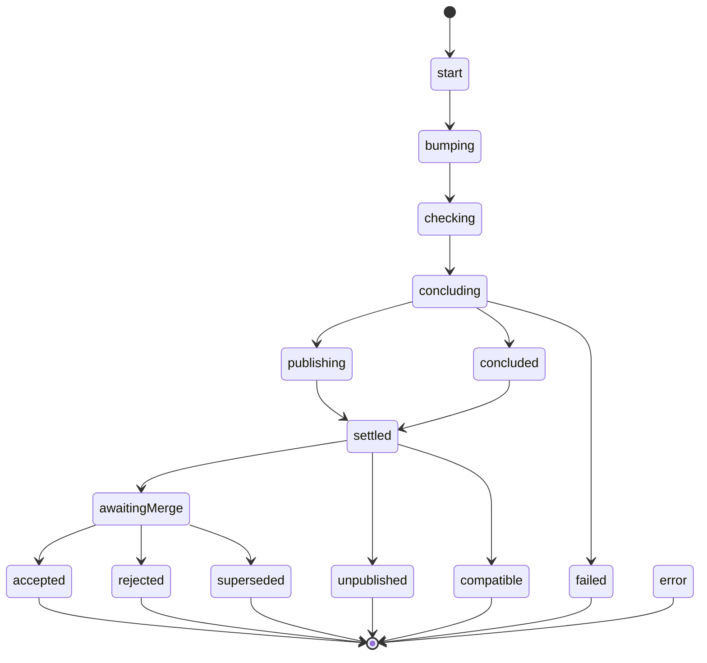

# Workflow reference

The migration workflow of one consumer and one target release, as the statechart in `src/workflow/machine.ts` defines it. This page is generated from `src/workflow/machine.ts` by `scripts/references.ts`; edit the source, not this page. The design is in [the workflow design](../design/workflow.md).

## Overview

Top-level states only; a transition out of a nested state is drawn from its parent. Any state goes to `error` on `activity.error`.

## States

An *activity* state asks the engine for one activity and leaves on its result. A *decision* state leaves immediately on the first guard that holds. A *waiting* state leaves only on an event from outside the job.

| State | Kind | Activity | Description |
| --- | --- | --- | --- |
| `start` | decision |  |  |
| `bumping` | activity | `bump` | Add target support to the runtime dsh declarations, engines.dsh included, without raising their minimum; move development dependencies to the target; optionally raise each plugin version. |
| `checking` | group |  | One pass of checks on the bumped tree; the first failure ends it. |
| `checking.next` | decision |  |  |
| `checking.running` | activity | computed from the context | Run the next check of the pass. |
| `concluding` | activity | `inspectTree` | Decide what the tree that came out of the checks becomes: a proposal, a local change, or nothing. |
| `publishing` | activity | computed from the context | Push the proposal branch and open or update the issue and the pull request, as a draft when a check failed. |
| `concluded` | decision |  |  |
| `settled` | decision |  |  |
| `awaitingMerge` | waiting |  | Wait for the maintainer to merge, close, or replace the proposal. |
| `compatible` | final |  | The bumped tree passes every check, and nothing changed, so there is nothing to propose. |
| `unpublished` | final |  | The tree changed and publishing is turned off. |
| `failed` | final |  | A check failed and the bump changed nothing, so there is nothing to propose. |
| `accepted` | final |  | The proposal was merged. |
| `rejected` | final |  | The proposal was closed without merging. |
| `superseded` | final |  | A later migration took over the proposal. |
| `error` | final |  | An activity failed for a reason outside the plugin. |

## Transitions

Transitions of one state are tried in order; the first whose guard holds is taken.

| From | On | Guard | To |
| --- | --- | --- | --- |
| any | `activity.error` | — | `error` |
| `start` | immediately | — | `bumping` |
| `bumping` | `bump.done` | — | `checking` |
| `checking.next` | immediately | `queueEmpty` | `concluding` |
| `checking.next` | immediately | — | `checking.running` |
| `checking.running` | `check.done` | `checkFailed` | `concluding` |
| `checking.running` | `check.done` | — | `checking.next` |
| `concluding` | `tree.inspected` | `changedAndPublish` | `publishing` |
| `concluding` | `tree.inspected` | `changed` | `concluded` |
| `concluding` | `tree.inspected` | `failureRecorded` | `failed` |
| `concluding` | `tree.inspected` | — | `concluded` |
| `publishing` | `proposal.published` | — | `settled` |
| `concluded` | immediately | — | `settled` |
| `settled` | immediately | `concludedIn(awaitingMerge)` | `awaitingMerge` |
| `settled` | immediately | `concludedIn(unpublished)` | `unpublished` |
| `settled` | immediately | — | `compatible` |
| `awaitingMerge` | `pull-request.closed` | `proposalMerged` | `accepted` |
| `awaitingMerge` | `pull-request.closed` | `proposalClosed` | `rejected` |
| `awaitingMerge` | `proposal.superseded` | — | `superseded` |

## Guards

| Guard | Holds when |
| --- | --- |
| `queueEmpty` | Every check of the pass has run. |
| `checkFailed` | The check failed. |
| `changedAndPublish` | The tree changed and publishing is on. |
| `changed` | The tree changed. |
| `failureRecorded` | A check failed, so the migration has nothing verified to propose. |
| `concludedIn` | The migration concluded in the given state. |
| `proposalMerged` | The closed pull request is this proposal, and it was merged. |
| `proposalClosed` | The closed pull request is this proposal. |
| `proposalMergedNow` | The closed pull request is this proposal, it was merged, and no merge was recorded yet. |
| `proposalClosedOpen` | The closed pull request is this proposal, and no merge was recorded yet. |

## The checks

A migration runs mechanical, boot, web, in that order, and stops at the first failure. A check the consumer turned off is left out.

## Events

Every activity result and every event from outside the job, as the event log stores it.

| Event | Fields |
| --- | --- |
| `bump.done` | `changes`, `detail` |
| `check.done` | `result` |
| `tree.inspected` | `changed`, `files` |
| `proposal.published` | `proposal` |
| `activity.error` | `activity`, `detail` |
| `pull-request.closed` | `number`, `merged`, `mergeSha` |
| `proposal.superseded` | `by` |
